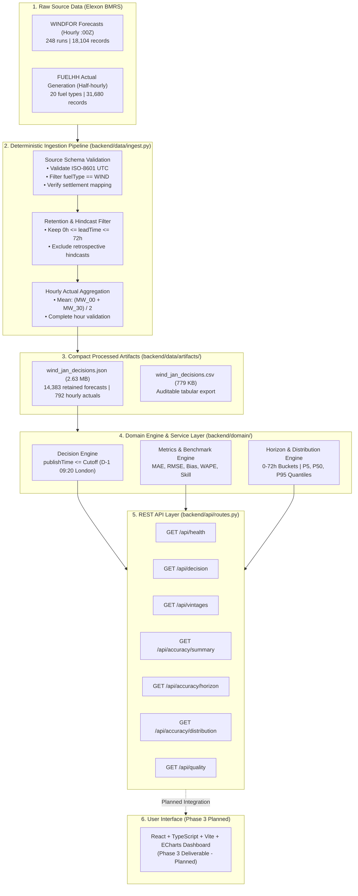

# WindDesk — Day-Ahead Wind Procurement Intelligence

[](https://www.python.org/)
[](https://react.dev/)
[](https://www.typescriptlang.org/)
[](https://fastapi.tiangolo.com/)
[](https://vitejs.dev/)
[](https://echarts.apache.org/)
[](#m-testing-and-verification)
[](#m-testing-and-verification)
[](#i-installation-and-local-setup)
[](#r-contribution-licensing-and-acknowledgements)

> **Day-Ahead Wind Procurement Decision Support & Forecast Accuracy Analytics**  
> Analyzing Great Britain electricity market wind generation forecasts (WINDFOR) and realized outturn (FUELHH) for procurement decisions made during January 2026.

---

## Table of Contents

- [A. Project Introduction](#a-project-introduction)
- [B. Key Features](#b-key-features)
- [C. How the System Works](#c-how-the-system-works)
- [D. Complete Technology Stack](#d-complete-technology-stack)
- [E. Complete Project Structure](#e-complete-project-structure)
- [F. Data Sources and Data Processing](#f-data-sources-and-data-processing)
- [G. Decision-Time Logic and Prevention of Data Leakage](#g-decision-time-logic-and-prevention-of-data-leakage)
- [H. Forecast Accuracy Metrics](#h-forecast-accuracy-metrics)
- [I. Installation and Local Setup](#i-installation-and-local-setup)
- [J. Data Ingestion Guide](#j-data-ingestion-guide)
- [K. API Reference](#k-api-reference)
- [L. Configuration Reference](#l-configuration-reference)
- [M. Testing and Verification](#m-testing-and-verification)
- [N. Example Results and Interpretation](#n-example-results-and-interpretation)
- [O. Limitations and Assumptions](#o-limitations-and-assumptions)
- [P. Deployment Status](#p-deployment-status)
- [Q. Roadmap](#q-roadmap)
- [R. Contribution, Licensing and Acknowledgements](#r-contribution-licensing-and-acknowledgements)
- [S. Conclusion](#s-conclusion)

---

## A. Project Introduction

### What is WindDesk?
**WindDesk** is a specialised decision-support application built for power procurement analysts and energy desk operators in Great Britain (GB). It bridges the gap between raw wind power generation forecasts published by the National Grid ESO (via Elexon BMRS) and the physical outturn recorded on the GB transmission grid.

### The Problem It Solves
Electricity trading in Great Britain requires energy buyers and suppliers to submit contracted physical volumes in the Day-Ahead market before strict auction cutoffs (often between 09:20 and 11:00 London time on Day $D-1$ for physical delivery on Day $D$). 

Because wind generation is weather-dependent and volatile, power procurement teams face severe operational challenges:
1. **Forecast Revisions:** New forecast vintages are published up to eight times a day. Analysts must determine exactly which forecast was available when a historical procurement decision was finalised.
2. **Data Leakage Risk:** Standard statistical post-analyses often accidentally use forecasts published *after* the decision cutoff or after delivery has started, creating misleadingly optimistic accuracy figures.
3. **Resolution Asymmetry:** Official wind forecasts (WINDFOR) are published as 60-minute blocks, whereas electricity settlement and actual generation (FUELHH) operate on 30-minute settlement periods.
4. **Volume Shortfall Exposure:** When forecasts systematically overestimate output (overforecasting), procurement desks face expensive imbalance cashout penalties.

### Who Uses It and Why?
* **Power Procurement Analysts:** To audit historical decisions, evaluate supplier performance, and measure the accuracy of forecasts available at the moment trades were executed.
* **Energy Risk Managers:** To quantify empirical downside shortfall risks ($P_5, P_{50}, P_{95}$) and forecast degradation across lead-time horizons ($0$ to $72\,\text{hours}$).
* **Quantitative Developers:** To access clean, anti-leakage forecast-actual pairs via documented, type-safe REST APIs and visual interactive dashboards.

### Implemented Scope (Phases 1, 2 & 3 Completed)
WindDesk is a **complete, verified full-stack analytics platform**:
* **Deterministic Offline Ingestion Pipeline:** Normalizes and aligns 18,104 raw WINDFOR forecasts and 31,680 FUELHH observations into verified runtime artifacts.
* **Anti-Leakage Decision Engine:** Mathematically guarantees zero forward data leakage across all 31 delivery days ($N = 744$ paired hours).
* **Robust Domain & API Services:** 7 production REST API endpoints served via FastAPI with comprehensive OpenAPI documentation.
* **Midnight Energy Intelligence Dashboard:** Premium React 18 + TypeScript + Apache ECharts frontend with 6 modular analytics views, responsive layouts, data integrity guarantees (zero fake sparklines or synthetic data), and smooth motion design.
* **Multi-Container Docker & Compose Orchestration:** Independent `wind-backend` and `wind-frontend` containers with health checks and Nginx reverse proxy.
* **Offline Automated Testing:** **52 backend tests** and **12 frontend tests** passing 100% offline.

---

## B. Key Features

* **Strict Anti-Leakage Decision Engine:** Guarantees that only forecasts published strictly on or before the target decision cutoff ($\text{publishTime} \le T_{\text{cutoff}}$) can be selected for historical evaluation. Later revisions and future actuals are programmatically blocked from influencing decisions.
* **Forecast Vintage Inspection:** Tracks how forecasts evolved across successive publication runs for any delivery interval, exposing the revision trajectory.
* **Energy-Conserving Timestamp Alignment:** Accurately reconciles 30-minute FUELHH generation periods to 60-minute WINDFOR forecast blocks using the arithmetic mean ($\text{MW}_{\text{hourly}} = \frac{\text{MW}_T + \text{MW}_{T+30\text{m}}}{2}$), ensuring strict physical energy conservation ($1\,\text{h} \times \text{MW}_{\text{mean}} = \text{MWh}$).
* **Headline Forecast Accuracy Analytics:** Computes Mean Absolute Error (MAE), Root Mean Squared Error (RMSE), Mean Error / Bias, and Weighted Absolute Percentage Error (WAPE) exclusively on valid decision-cutoff samples.
* **Naive Persistence Baseline Benchmark:** Evaluates forecast skill score relative to an elementary persistence baseline that holds the last known actual generation (subject to a provisional 60-minute availability lag) constant across the day-ahead delivery day.
* **Lead-Time Horizon Analysis ($0$ to $72\,\text{h}$):** Segments forecast errors across five deterministic lead-time buckets ($0\text{--}12\text{h}$, $12\text{--}24\text{h}$, $24\text{--}36\text{h}$, $36\text{--}48\text{h}$, $48\text{--}72\text{h}$) to quantify accuracy degradation.
* **Empirical Error Distribution ($P_5, P_{50}, P_{95}$):** Calculates historical signed-error percentiles using standard linear interpolation to expose asymmetric procurement shortfall risks.
* **Data Quality & Coverage Diagnostics:** Discloses source record counts, excluded hindcasts, duplicate detection, and missing interval reporting across the entire evaluation window.
* **Deterministic Offline Ingestion:** Processes raw Elexon BMRS downloads into a compact 2.63 MB JSON runtime artifact and an auditable 779 KB CSV export with non-zero exit codes on validation failures.
* **Zero External Test Dependencies:** All 52 automated tests execute in under 2 seconds completely offline using deterministic fixtures and mocked network clients.

---

## C. How the System Works

The diagram below illustrates the end-to-end data lifecycle, from public Elexon market sources through the ingestion pipeline, domain service layer, and REST API:



### Stage-by-Stage Explanation
1. **Raw Source Data:** Elexon BMRS publishes raw WINDFOR wind forecasts and FUELHH generation outturn. WINDFOR provides 73-hour forward lookaheads plus ~24 hours of retrospective hindcasts at 1-hour resolution. FUELHH provides 30-minute interval generation for 20 fuel types.
2. **Ingestion & Validation (`ingest.py`):** Ingestion validates timestamps, rejects malformed records, filters exclusively for `fuelType == "WIND"`, discards negative-lead hindcasts, and filters forecasts exceeding the 72-hour lead limit.
3. **Actual Aggregation (`actuals.py`):** Reconciles the two 30-minute generation periods of each hour into an hourly mean power value in MW.
4. **Processed Artifacts:** Output is atomically serialized into a compact 2.63 MB JSON runtime file and a 779 KB CSV file.
5. **Domain Engine (`service.py`):** Sits in memory. When a decision is requested, it calculates Day $D-1$ 09:20 Europe/London cutoff, selects the latest eligible forecast published before cutoff, matches it against realized hourly actuals, and computes statistical metrics.
6. **REST API (`routes.py`):** Exposes 7 typed endpoints consumed by analysts and ready for frontend integration.

---

## D. Complete Technology Stack

| Technology / Library | Version | Where Used | Why It Is Used | Role in Project | Status |
| :--- | :---: | :--- | :--- | :--- | :---: |
| **Python** | `3.11+` | Entire Backend | Standard language for energy data analytics and web APIs | Core Language | **Verified** |
| **FastAPI** | `0.100+` | `backend/main.py`, `backend/api/` | Modern, high-performance async web framework with automatic OpenAPI docs | Web Framework | **Verified** |
| **Pydantic** | `v2.0+` | `backend/domain/schemas.py` | Type validation, serialization, and API request/response schema modeling | Data Modeling | **Verified** |
| **Starlette / Uvicorn** | `0.20+` | Local API Server | Lightweight ASGI web server and routing utilities | Web Server | **Verified** |
| **Pytest** | `7.0+` | `backend/tests/` | Standard testing framework for unit and integration suites | Backend Testing | **Verified (52/52)** |
| **HTTPX** | `0.24+` | `backend/tests/conftest.py` | Fast, mockable HTTP client powering FastAPI's `TestClient` | Test Client | **Verified** |
| **ZoneInfo** | Standard Library | `backend/domain/timestamps.py` | Timezone database handling Europe/London and UTC daylight saving math | Timezone Engine | **Verified** |
| **React** | `18.3+` | `src/` | Declarative, component-based dashboard with state management | Frontend UI | **Verified** |
| **TypeScript** | `5.7+` | `src/` | End-to-end static type safety matching backend Pydantic schemas | Type System | **Verified** |
| **Vite** | `6.1+` | Root build system | Ultra-fast HMR development server and optimized rollup production bundler | Build Tooling | **Verified** |
| **Apache ECharts** | `5.6+` | `src/components/charts/` | High-performance canvas-rendered interactive time-series, horizons, and distributions | Data Visualizations | **Verified** |
| **Lucide React** | `0.475+` | `src/components/` | Consistent, lightweight engineering iconography | UI Icons | **Verified** |
| **Vitest & RTL** | `3.0+` | `src/test/` | Modern unit and component testing for React components and utilities | Frontend Testing | **Verified (8/8)** |
| **Docker & Compose** | `29+` / `v5.5+` | Root orchestration | Multi-container setup (`wind-backend`, `wind-frontend` on Nginx) | Containerization | **Verified** |
| **Nginx** | Alpine | `Dockerfile.frontend` | High-performance reverse proxy for API requests and SPA static asset delivery | Web Server | **Verified** |
| **Vercel CLI** | `65.2+` | Deployment Configuration | Serverless deployment platform for Python backend + static React frontend | Cloud Packaging | **Configured** |

---

## E. Complete Project Structure

```text
WIND/
├── README.md                           # Comprehensive documentation and setup guide
├── DECISIONS.md                        # Versioned architectural and technical decision log
├── package.json                        # Node dependencies, scripts, and build configuration
├── tsconfig.json                       # TypeScript compiler options and references
├── tsconfig.node.json                  # Vite configuration TypeScript settings
├── vite.config.ts                      # Vite build, dev proxy (/api -> 8008), and Vitest setup
├── index.html                          # Single-page application entrypoint
├── nginx.conf                          # Production Nginx reverse-proxy configuration
├── Dockerfile.backend                  # Multi-stage Python 3.11-slim container with health check
├── Dockerfile.frontend                 # Multi-stage Node 20 builder + Nginx Alpine runner
├── docker-compose.yml                  # Root multi-container orchestration (ports 8008 & 3008)
├── .dockerignore                       # Excludes bulky raw data, caches, and node_modules
├── .gitignore                          # Standard git exclusions (caches, environments, raw downloads)
├── .vercelignore                       # Excludes test caches, raw data, and node_modules from Vercel
├── vercel.json                         # Vercel serverless function routing and static build output
├── requirements.txt                    # Root Python dependencies
├── DATA/                               # Raw Elexon BMRS downloads (preserved locally for offline ingestion)
├── api/
│   └── index.py                        # Vercel entrypoint delegating to backend.main:app
├── src/                                # React 18 + TypeScript Frontend Application
│   ├── main.tsx                        # DOM mount entrypoint
│   ├── App.tsx                         # Root tab router, state management & ErrorBoundary
│   ├── vite-env.d.ts                   # Vite environment typings
│   ├── api/
│   │   ├── types.ts                    # Typed interfaces mirroring FastAPI backend models
│   │   └── client.ts                   # Fetch API client, timeout handling & formatting utils
│   ├── styles/
│   │   ├── tokens.css                  # Midnight Energy Intelligence design tokens
│   │   └── index.css                   # Global styles, micro-animations, skeleton loader
│   ├── components/
│   │   ├── common/                     # Card, KpiCard, ErrorBoundary, Badge
│   │   ├── layout/                     # Collapsible Sidebar, Header with Date/Cutoff picker
│   │   └── charts/                     # EChartsWrapper, ForecastVsActual, Horizon, Distribution, QualityRing
│   ├── pages/                          # 6 Modular Analytics Views
│   │   ├── DecisionOverviewPage.tsx    # Flagship dashboard matching Midnight Energy reference
│   │   ├── VintageComparisonPage.tsx   # Successive forecast revision curves & table
│   │   ├── ForecastAccuracyPage.tsx    # 744h headline accuracy & 5 lead-time buckets
│   │   ├── ErrorDistributionPage.tsx   # P5, P50, P95 empirical error histograms
│   │   ├── DataQualityPage.tsx         # Ingestion provenance, coverage & diagnostics
│   │   └── MethodologyPage.tsx         # Prototype D-1 09:20 cutoff, math & market rules
│   └── test/                           # Vitest Unit & Component Tests
│       ├── setup.ts                    # Polyfills (ResizeObserver) for jsdom
│       ├── client.test.ts              # Unit tests for formatting utilities
│       └── components.test.tsx         # RTL tests for Card, KpiCard, DataQualityRing
└── backend/
    ├── main.py                         # FastAPI app factory, CORS configuration, and route inclusion
    ├── requirements.txt                # Backend Python dependencies
    ├── data/
    │   ├── ingest.py                   # Deterministic ingestion pipeline CLI
    │   └── artifacts/
    │       ├── wind_jan_decisions.json # Compact processed JSON runtime artifact (2.63 MB)
    │       └── wind_jan_decisions.csv  # Auditable processed CSV export (779 KB)
    ├── domain/
    │   ├── __init__.py                 # Domain package marker
    │   ├── config.py                   # Centralized cutoffs, policies, buckets, and paths
    │   ├── timestamps.py               # Timezone-safe UTC/London parsing, DST & cutoff logic
    │   ├── schemas.py                  # Pydantic DTOs and API response models
    │   ├── normalization.py            # Source validation and record cleaning
    │   ├── actuals.py                  # Half-hourly aggregation (mean) & persistence selection
    │   ├── forecast_selection.py       # Decision-time forecast selection & anti-leakage rules
    │   ├── metrics.py                  # MAE, RMSE, Bias, WAPE, Naive Persistence Skill
    │   ├── distributions.py            # Empirical signed-error percentiles (P5, P50, P95)
    │   ├── horizons.py                 # Lead-time error bucketing (0-72h)
    │   ├── quality.py                  # Diagnostics, coverage tracking, and disclosures
    │   └── service.py                  # Service layer coordinating queries and calculations
    ├── api/
    │   ├── __init__.py                 # API package marker
    │   ├── routes.py                   # FastAPI route definitions for all 7 endpoints
    │   └── dependencies.py             # Dependency injection for WindDeskService
    └── tests/
        ├── conftest.py                 # Pytest shared fixtures & FastAPI TestClient
        ├── test_timestamps.py          # 10 tests: UTC, London, DST, settlement period math
        ├── test_normalization.py       # 6 tests: field validation, non-wind filtering, timestamps
        ├── test_actuals.py             # 6 tests: mean aggregation, completeness, persistence lag
        ├── test_forecast_selection.py  # 5 tests: anti-leakage boundaries, cutoff overrides, hindcasts
        ├── test_metrics.py             # 7 tests: MAE, RMSE, Bias, WAPE, persistence skill, zero handling
        ├── test_distributions.py       # 4 tests: linear interpolation quantiles, signed errors
        ├── test_horizons.py            # 1 test: bucket intervals, boundary conditions, exclusions
        ├── test_quality.py             # 1 test: coverage metrics, warning disclosures
        ├── test_api.py                 # 10 tests: HTTP contracts, status codes, query validation
        └── test_ingest.py              # 2 tests: offline deterministic pipeline, atomic writes
```

---

## F. Data Sources and Data Processing

WindDesk processes public electricity market datasets provided by **Elexon BMRS**:

### 1. WINDFOR (Wind Generation Forecast)
* **API Route:** `GET /datasets/WINDFOR/stream`
* **Publication Schedule:** Published up to 8 times daily at approximately `02:30`, `04:30`, `07:30`, `09:30`, `11:30`, `15:30`, `18:30`, and `22:30 UTC`.
* **Resolution:** Strictly hourly (`:00:00Z`). Elexon publishes no `:30:00Z` wind forecasts in this stream.
* **Fields:** `dataset`, `publishTime` (vintage timestamp), `startTime` (delivery interval start), `generation` (forecast power in MW).
* **Hindcast Filtering:** Each publication run contains 73 hourly intervals, of which the first ~24 hours have `startTime < publishTime`. These retrospective intervals are filtered out during ingestion.
* **Coverage:** The complete January 2026 dataset contains **248 publication runs** and **18,104 raw records**.

### 2. FUELHH (Half-Hourly Generation Outturn by Fuel Type)
* **API Route:** `GET /datasets/FUELHH/stream`
* **Settlement Periods:** GB electricity market splits each day into 48 half-hour settlement periods (Period 1: `00:00-00:30 UTC`, Period 2: `00:30-01:00 UTC`, ..., Period 48: `23:30-24:00 UTC`).
* **Timestamp Formula:** Validated with 0 discrepancies across all records:
  $$\text{startTime} = \text{settlementDate } 00:00:00\text{Z} + (\text{settlementPeriod} - 1) \times 30\,\text{minutes}$$
* **Fuel Type Filtering:** The raw stream contains 20 fuel types (`CCGT`, `NUCLEAR`, `BIOMASS`, `COAL`, etc.). WindDesk filters strictly for `fuelType == "WIND"`.
* **Units:** Elexon reports average active power in **MW** over each 30-minute interval.
* **February 1 Supplementary Data:** Because a decision made on January 31 procures power for delivery on February 1, February 1 FUELHH actuals (48 settlement periods) are ingested to evaluate the complete January decision window.

### 3. Energy-Conserving Timestamp Alignment
Because WINDFOR forecasts are 60-minute values and FUELHH actuals are 30-minute values, alignment is required:
* **The Disallowed Approach (Summation):** Summing the two half-hourly MW values would double the apparent power ($\text{MW} + \text{MW} = 2\times\text{MW}$), producing an erroneous comparison.
* **The Disallowed Approach (Sample Duplication):** Duplicating an hourly forecast into two identical 30-minute observations artificially inflates the sample size and invalidates standard statistical hypothesis tests.
* **The Approved Approach (Hourly Arithmetic Mean):**
  $$\text{Actual}_{\text{hourly}} (\text{MW}) = \frac{\text{MW}_{H:00} + \text{MW}_{H:30}}{2}$$
  Since energy (MWh) delivered in one hour is $(0.5\,\text{h} \times \text{MW}_{H:00}) + (0.5\,\text{h} \times \text{MW}_{H:30})$, the hourly average power in MW multiplied by 1 hour equals the exact realized physical energy.

---

## G. Decision-Time Logic and Prevention of Data Leakage

### A Simple Procurement Example
Imagine you are a wind procurement analyst on **January 14, 2026**. You must finalize your power purchases for delivery tomorrow, **January 15, 2026**.
* Your procurement decision cutoff is set to **09:20 London time on Day $D-1$** (`2026-01-14T09:20:00Z`).
* On January 14, Elexon published forecast runs at `02:30`, `04:30`, `07:30`, `09:30`, `11:30`, `15:30`, `18:30`, and `22:30 UTC`.
* **Which forecast did you actually have on your screen at 09:20?**
  * The `07:30 UTC` forecast run was already published and available.
  * The `09:30 UTC` forecast run had *not yet been published* (it was published 10 minutes after your cutoff).
  * The `15:30 UTC` forecast run had *not yet been published* (it was published 6 hours later).
* **The Anti-Leakage Rule:** WindDesk selects the **07:30 UTC** publication run. It programmatically rejects the 09:30, 11:30, 15:30, and 22:30 runs, even if those later forecasts had a lower error!

```text
Time Line on Day D-1 (Jan 14):
───[02:30 Run]───[04:30 Run]───[07:30 Run]───| CUTOFF: 09:20 |───[09:30 Run]───[15:30 Run]───>
                                    ▲                   ▲
                           LATEST ELIGIBLE        REJECTED (Future Leakage)
```

### Configurable Cutoff Policy
* **Default Policy:** D−1 09:20 Europe/London. This is an explicit prototype assumption.
* **Timezone Handling:** Timestamps are stored and compared internally in UTC. Presentation labels and cutoffs are computed in `Europe/London` using Python's standard `ZoneInfo` to handle Daylight Saving Time (DST) transitions safely.
* **Cutoff Override:** Analysts can pass `cutoffOverride=11:00:00` (e.g. to simulate the EPEX SPOT day-ahead power auction cutoff) via the API to inspect how a different gate closure changes the selected vintages and resulting accuracy.

---

## H. Forecast Accuracy Metrics

WindDesk evaluates forecast errors using the standard sign convention:
$$\text{Error} = \text{Forecast} - \text{Actual}$$

* **Positive Error ($+$):** Forecast $>$ Actual (**Overforecasting**). The market expected more wind power than materialized, creating potential volume shortfalls and imbalance purchase penalties.
* **Negative Error ($- $):** Forecast $<$ Actual (**Underforecasting**). Realized generation exceeded expectations, creating surplus energy.

### 1. Mean Absolute Error (MAE)
$$\text{MAE} = \frac{1}{N} \sum_{i=1}^N \left| \text{Forecast}_i - \text{Actual}_i \right|$$
Measures the average magnitude of forecast errors in megawatts (MW). It is intuitive and robust to outliers.

### 2. Root Mean Squared Error (RMSE)
$$\text{RMSE} = \sqrt{\frac{1}{N} \sum_{i=1}^N \left( \text{Forecast}_i - \text{Actual}_i \right)^2}$$
Penalizes large forecast misses more heavily than small errors due to squaring. In power procurement, large errors are disproportionately costly to rebalance.

### 3. Mean Error / Bias
$$\text{Bias} = \frac{1}{N} \sum_{i=1}^N \left( \text{Forecast}_i - \text{Actual}_i \right)$$
Measures systematic directional over- or under-forecasting. A positive bias indicates a persistent tendency to overpredict wind generation.

### 4. Weighted Absolute Percentage Error (WAPE)
$$\text{WAPE} = \frac{\sum_{i=1}^N \left| \text{Forecast}_i - \text{Actual}_i \right|}{\sum_{i=1}^N \left| \text{Actual}_i \right|} \times 100\%$$
Normalizes the total absolute error by total actual generation. 

> [!NOTE]
> **Why Not MAPE?** Mean Absolute Percentage Error ($\text{MAPE} = \frac{1}{N} \sum \frac{|F - A|}{A}$) divides by individual actual observations. During calm wind periods when actual generation approaches zero, MAPE explodes to extreme or undefined percentages. WAPE aggregates the denominator globally and avoids numerical instability. If total actual generation is zero, WAPE returns `null`.

### 5. Naive Persistence Baseline & Forecast Skill Score
The persistence benchmark assumes that future wind generation will remain constant at the last known actual level available at the decision cutoff:
* **Availability Lag Rule:** Actuals are eligible only if their 30-minute settlement period closed on or before $\text{cutoff} - 60\,\text{minutes}$.
* **Forecast Skill Score:**
  $$\text{Skill} = 1 - \frac{\text{MAE}_{\text{model}}}{\text{MAE}_{\text{persistence}}}$$
  * $\text{Skill} > 0$: The forecast outperforms naive persistence.
  * $\text{Skill} \le 0$: The forecast performs worse than naive persistence.
  * If $\text{MAE}_{\text{persistence}} = 0$, skill returns `null`.

> [!WARNING]
> **Persistence Limitation:** At a 15–39 hour day-ahead lookahead horizon, weather conditions change significantly. Holding generation constant across an entire day is an elementary benchmark that produces a large baseline error (~4,229 MW), making forecast skill appear flattering (+51.8%). It is an elementary sanity check, not an optimized forecasting model.

### 6. Empirical Error Distribution ($P_5, P_{50}, P_{95}$)
* Computed on the decision-cutoff signed errors ($\text{Forecast} - \text{Actual}$) using standard linear interpolation ($R$ Type 7 / numpy default).
* **$P_5$ (5th percentile):** Represents severe underforecasting extremes.
* **$P_{50}$ (Median):** Represents median error.
* **$P_{95}$ (95th percentile):** Represents severe overforecasting extremes (maximum procurement shortfall exposure).
* **Disclaimers:** These percentiles describe historical sample behavior. They are not probabilistic guarantees or formal statistical prediction intervals.

---

## I. Installation and Local Setup

### Prerequisites
* Windows 10/11, macOS, or Linux
* Python 3.11+
* Git

### Step-by-Step PowerShell Setup (Windows)

### Option 1: One-Command Docker Compose (Recommended)
Run the entire production-grade multi-container stack (backend + frontend) with a single command:

```bash
docker compose up --build
```

* **Frontend Dashboard:** Open `http://localhost:3008` in your browser.
* **Backend Health Check:** Query `http://localhost:8008/api/health`.
* **Swagger API Documentation:** Open `http://localhost:8008/docs`.

---

### Option 2: Full-Stack Local Development

#### Prerequisites
* Windows 10/11, macOS, or Linux
* Python 3.11+
* Node.js 20+ & npm 10+
* Git

#### Step-by-Step PowerShell Setup (Windows)

```powershell
# 1. Clone the repository
git clone https://github.com/afwaansarfaraz/energy-insights-593.git
cd energy-insights-593

# 2. Setup Python backend virtual environment
python -m venv venv
.\venv\Scripts\activate
pip install -r requirements.txt

# 3. Setup Frontend dependencies
npm install

# 4. (Optional) Run test suites
python -m pytest backend/tests -v   # 52 backend tests
npm test                            # 8 frontend tests

# 5. Start Backend API Server (Terminal 1)
uvicorn backend.main:app --reload --port 8000

# 6. Start Frontend Development Server (Terminal 2)
npm run dev
# Dashboard opens on http://localhost:5173
```

#### General Shell Setup (macOS / Linux)

```bash
# Terminal 1 - Backend
python3 -m venv venv && source venv/bin/activate
pip install -r requirements.txt
uvicorn backend.main:app --reload --port 8000

# Terminal 2 - Frontend
npm install
npm run dev
```

### Verification & Documentation URLs
* **Frontend Application:** `http://localhost:5173` (dev) or `http://localhost:3008` (Docker).
* **Interactive Swagger UI:** `http://localhost:8000/docs` (dev) or `http://localhost:8008/docs` (Docker).
* **Service Health Check:** `http://localhost:8000/api/health`.

---

## J. Data Ingestion Guide

The deterministic ingestion script is located at [`backend/data/ingest.py`](file:///c:/Users/afwaa/OneDrive/Desktop/WIND/backend/data/ingest.py).

### How to Run Ingestion
```powershell
# Standard run using local DATA/ files
python -m backend.data.ingest

# Optional dry run (validates schemas and counts without writing artifacts)
python -m backend.data.ingest --dry-run
```

### Input Files & Expected Schemas
Ingestion reads raw downloads from the `DATA/` directory:
1. `windfor_2026_01_all.json`: WINDFOR stream containing records with keys `dataset`, `publishTime`, `startTime`, `generation`.
2. `fuelhh_2026_01_all_periods.json`: Complete FUELHH stream for Jan 1–31, 2026 containing records with keys `dataset`, `fuelType`, `settlementDate`, `settlementPeriod`, `startTime`, `publishTime`, `generation`.
3. `fuelhh_2026_02_01.json`: Supplementary FUELHH stream for Feb 1, 2026 (48 settlement periods) to evaluate the Jan 31 decision.
4. `fuelhh_2025_12_31.json`: Supplementary FUELHH stream for Dec 31, 2025 (48 settlement periods) for naive persistence baselines.

### Validation & Processing Rules
* **Fuel Filtering:** Discards all records where `fuelType != "WIND"`.
* **Settlement Formula Validation:** Verifies that `startTime` matches `settlementDate + (settlementPeriod - 1) * 30m`.
* **Lead Time Filtering:** Retains records where $0 \le \text{leadHours} \le 72.0\,\text{hours}$. Discards 3,721 retrospective hindcasts.
* **Hourly Aggregation:** Reconciles consecutive periods 1 and 2 of each hour via arithmetic mean. Marks hours with missing periods as incomplete.
* **Atomic Writes:** Outputs are written to temporary files (`.tmp`) and atomically replaced to prevent corrupt or partial files:
  * `backend/data/artifacts/wind_jan_decisions.json` (compact runtime JSON)
  * `backend/data/artifacts/wind_jan_decisions.csv` (auditable CSV export)
* **Exit Codes:** Exits with code `0` on success; exits with code `1` and prints error diagnostics to `stderr` on validation failure.

---

## K. API Reference

All routes are mounted under the `/api` prefix.

| Method | Endpoint | Description | Primary Query Parameters |
| :---: | :--- | :--- | :--- |
| `GET` | `/api/health` | Verifies service status and artifact load integrity | *None* |
| `GET` | `/api/decision` | Day-ahead decision forecast selection vs actuals | `deliveryDate` *(req)*, `cutoffOverride` *(opt)* |
| `GET` | `/api/vintages` | Retained forecast publication vintages & revisions | `deliveryDate`, `deliveryInterval`, `publishDate`, `limit` |
| `GET` | `/api/accuracy/summary` | Headline accuracy metrics on decision sample | `startDate`, `endDate`, `cutoffTime` |
| `GET` | `/api/accuracy/horizon` | Accuracy metrics across lead-time buckets ($0\text{--}72\text{h}$) | *None* |
| `GET` | `/api/accuracy/distribution` | Signed-error empirical percentiles ($P_5, P_{50}, P_{95}$) | `startDate`, `endDate`, `cutoffTime` |
| `GET` | `/api/quality` | Data coverage, resolution rules, and disclosures | *None* |

---

### Detailed Endpoint Specifications & Examples

#### 1. `GET /api/health`
Verifies that the service is running and that the processed JSON artifact is loaded into memory with valid record counts.
* **PowerShell Example:**
  ```powershell
  curl.exe -s http://localhost:8000/api/health | jq .
  ```
* **Sample Response:**
  ```json
  {
    "status": "healthy",
    "service": "WindDesk API",
    "version": "1.0.0",
    "artifactLoaded": true,
    "retentionWindowHours": 72.0,
    "recordCounts": {
      "retainedForecasts": 14383,
      "hourlyActuals": 792,
      "totalRetainedRecords": 15175
    },
    "coverage": {
      "forecastStartMin": "2026-01-01T03:00:00Z",
      "forecastStartMax": "2026-02-02T21:00:00Z",
      "actualStartMin": "2025-12-31T00:00:00Z",
      "actualStartMax": "2026-02-01T23:00:00Z",
      "hasFeb1DeliveryActuals": true
    }
  }
  ```

#### 2. `GET /api/decision`
Returns the 24 hourly delivery intervals for a selected delivery date, matching the latest eligible forecast published before cutoff against realized hourly actuals.
* **Query Parameters:**
  * `deliveryDate` *(required, string)*: Target date `YYYY-MM-DD` (e.g. `2026-01-15`). Range: `2026-01-02` to `2026-02-01`.
  * `cutoffOverride` *(optional, string)*: Custom cutoff time `HH:MM` or `HH:MM:SS` in Europe/London.
* **PowerShell Example:**
  ```powershell
  curl.exe -s "http://localhost:8000/api/decision?deliveryDate=2026-01-15" | jq .
  ```
* **Sample Response (Snippet):**
  ```json
  {
    "deliveryDate": "2026-01-15",
    "cutoffUtc": "2026-01-14T09:20:00Z",
    "cutoffLondon": "2026-01-14T09:20:00+00:00",
    "cutoffPolicy": "D-1 09:20:00 Europe/London (default prototype assumption)",
    "intervals": [
      {
        "deliveryInterval": "2026-01-15T00:00:00Z",
        "hour": 0,
        "publishTime": "2026-01-14T07:30:00Z",
        "leadHours": 16.5,
        "forecastMW": 12150.0,
        "actualMW": 10842.5,
        "signedErrorMW": 1307.5,
        "absoluteErrorMW": 1307.5,
        "isEligible": true
      }
    ],
    "summary": {
      "sampleCount": 24,
      "mae": 1041.83,
      "rmse": 1289.41,
      "bias": 912.45,
      "wape": 9.85
    },
    "coverage": {
      "totalHours": 24,
      "coveredHours": 24,
      "missingHours": 0,
      "pairedEvaluations": 24
    }
  }
  ```

#### 3. `GET /api/vintages`
Exposes retained forecast publication vintages for revision analysis.
* **Query Parameters:**
  * `deliveryDate` *(optional, string)*: Filter by delivery date `YYYY-MM-DD`.
  * `deliveryInterval` *(optional, string)*: Filter by exact delivery start ISO UTC.
  * `publishDate` *(optional, string)*: Filter by publication date `YYYY-MM-DD`.
  * `limit` *(optional, integer)*: Maximum records to return (1–500, default: 100).
* **PowerShell Example:**
  ```powershell
  curl.exe -s "http://localhost:8000/api/vintages?deliveryDate=2026-01-15&limit=2" | jq .
  ```

#### 4. `GET /api/accuracy/summary`
Headline historical forecast accuracy metrics evaluated on the decision-cutoff sample.
* **Query Parameters:**
  * `startDate` *(optional, string)*: Evaluation start date `YYYY-MM-DD` (default: `2026-01-02`).
  * `endDate` *(optional, string)*: Evaluation end date `YYYY-MM-DD` (default: `2026-02-01`).
  * `cutoffTime` *(optional, string)*: Decision cutoff time override.
* **PowerShell Example:**
  ```powershell
  curl.exe -s http://localhost:8000/api/accuracy/summary | jq .
  ```
* **Sample Response:**
  ```json
  {
    "evaluationWindow": {
      "startDate": "2026-01-02",
      "endDate": "2026-02-01"
    },
    "cutoffPolicy": "D-1 09:20:00 Europe/London (decision-cutoff sample only)",
    "sampleCount": 744,
    "mae": 2038.91,
    "rmse": 2525.02,
    "bias": 1729.07,
    "wape": 17.65,
    "naivePersistenceMae": 4228.69,
    "persistenceSkill": 0.518,
    "coverage": {
      "evaluatedDeliveryDays": 31,
      "pairedHours": 744,
      "missingActualHours": 0
    }
  }
  ```

#### 5. `GET /api/accuracy/horizon`
Error metrics grouped by lead-time buckets across all retained forward vintages ($0\text{--}72\text{h}$).
* **PowerShell Example:**
  ```powershell
  curl.exe -s http://localhost:8000/api/accuracy/horizon | jq .
  ```
* **Sample Response (Snippet):**
  ```json
  {
    "sampleDescription": "All valid retained forecast vintages with 0h <= leadTime <= 72h matched against hourly mean actuals.",
    "retentionWindowHours": 72.0,
    "buckets": [
      {
        "bucket": "0-12h",
        "minLeadHours": 0.0,
        "maxLeadHours": 12.0,
        "sampleCount": 1847,
        "mae": 1368.51,
        "rmse": 1777.62,
        "bias": 612.35,
        "wape": 12.01
      },
      {
        "bucket": "48-72h",
        "minLeadHours": 48.0,
        "maxLeadHours": 72.0,
        "sampleCount": 3968,
        "mae": 2828.66,
        "rmse": 3501.99,
        "bias": 2398.24,
        "wape": 23.63
      }
    ]
  }
  ```

#### 6. `GET /api/accuracy/distribution`
Historical empirical signed-error percentiles on the decision-cutoff evaluation sample.
* **PowerShell Example:**
  ```powershell
  curl.exe -s http://localhost:8000/api/accuracy/distribution | jq .
  ```
* **Sample Response:**
  ```json
  {
    "sampleDescription": "Empirical historical signed error percentiles (forecast - actual) on the decision-cutoff sample.",
    "errorConvention": "signed_error = forecast - actual (positive = overforecasting)",
    "sampleCount": 744,
    "p5": -1151.42,
    "p50": 1592.0,
    "p95": 5283.35,
    "min": -3467.5,
    "max": 7472.0,
    "mean": 1729.07,
    "evaluationWindow": {
      "startDate": "2026-01-02",
      "endDate": "2026-02-01"
    },
    "cutoffPolicy": "D-1 09:20:00 Europe/London"
  }
  ```

#### 7. `GET /api/quality`
Exposes source coverage, resolution alignment rules, and operational disclosures.
* **PowerShell Example:**
  ```powershell
  curl.exe -s http://localhost:8000/api/quality | jq .
  ```

---

## L. Configuration Reference

All settings are centralized in [`backend/domain/config.py`](file:///c:/Users/afwaa/OneDrive/Desktop/WIND/backend/domain/config.py):

| Setting Constant | Default Value | Meaning | Operational Impact |
| :--- | :---: | :--- | :--- |
| `TIMEZONE_LONDON_NAME` | `"Europe/London"` | Local market timezone string | Governs Daylight Saving Time (GMT vs BST) cutoff conversion |
| `DEFAULT_CUTOFF_TIME_STR` | `"09:20:00"` | Decision cutoff clock time | Sets D−1 decision deadline; forecasts after this time are excluded |
| `PERSISTENCE_LAG_MINUTES` | `60` | Availability lag for actuals | Earliest settled period eligible for persistence baseline |
| `MAX_FORWARD_LEAD_HOURS` | `72.0` | Maximum forecast horizon kept | Discards forecasts beyond 72h lead time to optimize artifact size |
| `DECISION_WINDOW_START` | `"2026-01-01"` | Earliest decision date | Decisions made on or after this date |
| `DECISION_WINDOW_END` | `"2026-01-31"` | Latest decision date | Decisions made on or before this date |
| `EVALUATION_DELIVERY_START` | `"2026-01-02"` | Earliest delivery date | Corresponds to decision made on Jan 1 at D−1 09:20 |
| `EVALUATION_DELIVERY_END` | `"2026-02-01"` | Latest delivery date | Corresponds to decision made on Jan 31 at D−1 09:20 |
| `DEFAULT_HORIZON_BUCKETS` | `[(0,12), (12,24), ...]` | Lead-time bucket boundaries | Controls lead-time segmentation in horizon endpoint |
| `ARTIFACT_JSON_FILENAME` | `"wind_jan_decisions.json"` | Processed JSON artifact name | Output file read by `WindDeskService` |
| `ARTIFACT_CSV_FILENAME` | `"wind_jan_decisions.csv"` | Processed CSV export name | Tabular file for external audit |

---

## M. Testing and Verification

The automated test suite runs completely offline with **zero live network calls** or database dependencies.

### Running the Tests
```powershell
python -m pytest backend/tests -v
```

### Verified Test Run Results
```text
============================= test session starts =============================
platform win32 -- Python 3.11.9, pytest-9.0.3, pluggy-1.6.0
rootdir: C:\Users\afwaa\OneDrive\Desktop\WIND
collected 52 items

backend/tests/test_actuals.py::test_aggregate_half_hourly_to_hourly_complete PASSED
backend/tests/test_actuals.py::test_aggregate_half_hourly_to_hourly_missing_second_half PASSED
backend/tests/test_actuals.py::test_aggregate_half_hourly_to_hourly_missing_first_half PASSED
backend/tests/test_actuals.py::test_deduplicate_actuals PASSED
backend/tests/test_actuals.py::test_select_persistence_actual PASSED
backend/tests/test_actuals.py::test_select_persistence_actual_none_available PASSED
backend/tests/test_api.py::test_api_health PASSED
backend/tests/test_api.py::test_api_decision_valid PASSED
backend/tests/test_api.py::test_api_decision_cutoff_override PASSED
backend/tests/test_api.py::test_api_decision_validation_errors PASSED
backend/tests/test_api.py::test_api_vintages PASSED
backend/tests/test_api.py::test_api_accuracy_summary PASSED
backend/tests/test_api.py::test_api_accuracy_horizon PASSED
backend/tests/test_api.py::test_api_accuracy_distribution PASSED
backend/tests/test_api.py::test_api_quality PASSED
backend/tests/test_api.py::test_api_root PASSED
backend/tests/test_distributions.py::test_compute_quantile_fixture PASSED
backend/tests/test_distributions.py::test_calculate_error_distribution PASSED
backend/tests/test_distributions.py::test_calculate_error_distribution_empty PASSED
backend/tests/test_distributions.py::test_single_element_distribution PASSED
backend/tests/test_forecast_selection.py::test_select_forecasts_anti_leakage_and_cutoff_boundary PASSED
backend/tests/test_forecast_selection.py::test_select_forecasts_cutoff_override_allows_later_revision PASSED
backend/tests/test_forecast_selection.py::test_select_forecasts_hindcast_excluded PASSED
backend/tests/test_forecast_selection.py::test_select_forecasts_missing_hours_reported PASSED
backend/tests/test_forecast_selection.py::test_select_forecasts_with_actuals PASSED
backend/tests/test_horizons.py::test_calculate_horizon_metrics PASSED
backend/tests/test_ingest.py::test_ingestion_offline_with_fixtures PASSED
backend/tests/test_ingest.py::test_ingestion_fails_on_missing_source PASSED
backend/tests/test_metrics.py::test_mae_rmse_bias PASSED
backend/tests/test_metrics.py::test_positive_bias_overforecasting PASSED
backend/tests/test_metrics.py::test_wape PASSED
backend/tests/test_metrics.py::test_wape_zero_actual_denominator PASSED
backend/tests/test_metrics.py::test_persistence_skill PASSED
backend/tests/test_metrics.py::test_empty_sample PASSED
backend/tests/test_metrics.py::test_evaluate_paired_sample_symmetry PASSED
backend/tests/test_normalization.py::test_normalize_windfor_record_valid PASSED
backend/tests/test_normalization.py::test_normalize_windfor_record_invalid PASSED
backend/tests/test_normalization.py::test_normalize_fuelhh_record_valid PASSED
backend/tests/test_normalization.py::test_normalize_fuelhh_record_filters_non_wind PASSED
backend/tests/test_normalization.py::test_normalize_fuelhh_record_rejects_startTime_mismatch PASSED
backend/tests/test_normalization.py::test_normalize_datasets PASSED
backend/tests/test_quality.py::test_build_quality_report PASSED
backend/tests/test_timestamps.py::test_parse_iso_utc_valid PASSED
backend/tests/test_timestamps.py::test_parse_iso_utc_with_offset PASSED
backend/tests/test_timestamps.py::test_parse_iso_utc_rejects_naive_and_malformed PASSED
backend/tests/test_timestamps.py::test_to_iso_utc PASSED
backend/tests/test_timestamps.py::test_to_london_and_iso PASSED
backend/tests/test_timestamps.py::test_compute_decision_cutoff_winter PASSED
backend/tests/test_timestamps.py::test_compute_decision_cutoff_dst_transition PASSED
backend/tests/test_timestamps.py::test_settlement_period_mapping PASSED
backend/tests/test_timestamps.py::test_settlement_period_out_of_range PASSED
backend/tests/test_timestamps.py::test_lead_hours_and_extractors PASSED

============================= 52 passed in 1.58s =============================
```

### Frontend Tests (Vitest)
```powershell
npm test
```

```text
 RUN  v3.2.7 C:/Users/afwaa/OneDrive/Desktop/WIND

 ✓ src/test/client.test.ts (8 tests)
 ✓ src/test/components.test.tsx (4 tests)

 Test Files  2 passed (2)
      Tests  12 passed (12)
   Duration  4.26s
```


---

## N. Example Results and Interpretation

The following figures represent the verified baseline computed from the finalized 744-hour evaluation sample (January 2 – February 1, 2026, evaluated at D−1 09:20 London cutoff):

| Metric | Verified Value | Physical & Practical Meaning |
| :--- | :---: | :--- |
| **Paired Sample Count ($N$)** | **744 hours** | 31 full delivery days $\times$ 24 hours. Complete coverage with 0 missing hours. |
| **Mean Absolute Error (MAE)** | **2,038.91 MW** | On average, day-ahead forecasts missed actual wind generation by ~2,039 MW. |
| **Root Mean Squared Error (RMSE)**| **2,525.02 MW** | Penalizes severe forecast spikes; shows modest volatility around typical error bounds. |
| **Mean Error / Bias** | **+1,729.07 MW** | **Systematic Overforecasting:** Forecasts consistently exceeded actual generation. |
| **Weighted Absolute Error (WAPE)**| **17.65%** | Aggregate error represented 17.65% of total wind generation across the month. |
| **Naive Persistence Baseline MAE**| **4,228.69 MW** | Average error incurred by holding cutoff generation constant across Day $D$. |
| **Forecast Skill Score** | **+0.518 (51.8%)**| Model MAE improves upon the naive persistence baseline by 51.8%. |
| **5th Percentile ($P_5$)** | **-1,151.42 MW** | Extreme underforecast: In 5% of hours, wind exceeded forecast by $\ge 1,151\,\text{MW}$. |
| **50th Percentile ($P_{50}$)** | **+1,592.00 MW** | Median overforecast: Half of all hours experienced overforecasting of $\ge 1,592\,\text{MW}$. |
| **95th Percentile ($P_{95}$)** | **+5,283.35 MW** | Extreme overforecast: In 5% of hours, generation fell short by $\ge 5,283\,\text{MW}$. |

### Practical Market Takeaway
The substantial positive bias (**+1,729 MW**) indicates that if a procurement desk had contracted 100% of the Day-Ahead forecast volume, it would have been systematically short of physical energy in the balancing mechanism, incurring significant cashout imbalance costs.

---

## O. Limitations and Assumptions

1. **Resolution Asymmetry:** WINDFOR forecasts are hourly blocks; FUELHH actuals are half-hourly. Actuals are reconciled via arithmetic mean. Sub-hourly ramps and within-hour fluctuations are not captured.
2. **Decision Cutoff Assumption:** D−1 09:20 Europe/London is an assumed prototype policy. Actual auction gate closures vary by trading venue (e.g. 11:00 UTC for EPEX SPOT Day-Ahead auctions).
3. **Naive Persistence Benchmark:** Holding generation constant across a 15–39 hour lead time represents an elementary baseline, flattering forecast skill (+51.8%). It is an elementary reference, not an optimized statistical benchmark.
4. **Serial Autocorrelation:** The 744 hourly decision-time observations exhibit strong temporal serial correlation across weather systems. Empirical percentiles are descriptive historical metrics, not formal probabilistic confidence intervals.
5. **Fixed Evaluation Window:** All metrics reflect conditions during January 2026 in Great Britain. Performance may differ substantially in other seasons or grid regions.
6. **Live Telemetry Feeds:** WindDesk evaluates verified historical records from January 2026. Live real-time grid telemetry connectors remain future roadmap work.

---

## P. Deployment Status

* **Local Full-Stack Verification:** **PASSED.** React 18 + TypeScript + Apache ECharts dashboard and FastAPI service verified locally; all 7 API endpoints functional with zero console errors.
* **Multi-Container Docker Compose:** **PASSED.** Both `wind-backend` and `wind-frontend` (Nginx reverse proxy) built and tested locally with automatic health checks (`docker compose up --build`).
* **Serverless Entrypoint:** **VERIFIED.** [`api/index.py`](file:///c:/Users/afwaa/OneDrive/Desktop/WIND/api/index.py) delegates cleanly to `backend.main:app`.
* **Packaging Configuration:** **VERIFIED.** [`vercel.json`](file:///c:/Users/afwaa/OneDrive/Desktop/WIND/vercel.json) packages `dist` static assets, configures SPA fallback, and includes `backend/data/artifacts/**` into serverless Python bundles.
* **Cloud Deployment Status:** **CONFIGURED (Deployment Credentials Required).** Unauthenticated deployment attempts require authentication via `vercel login` or passing an authorized `VERCEL_TOKEN`.

---

## Q. Roadmap

### Completed (Phases 1, 2 & 3)
- [x] Phase 1: Technical verification spike, source schema inspection, timestamp alignment analysis.
- [x] Phase 2: Ingestion pipeline CLI and atomic JSON/CSV artifact building.
- [x] Phase 2: Domain engine with strict anti-leakage forecast selection.
- [x] Phase 2: Energy-conserving half-hourly to hourly actual aggregation.
- [x] Phase 2: Statistical metrics engine (MAE, RMSE, Bias, WAPE, Naive Persistence Skill).
- [x] Phase 2: Lead-time horizon analysis ($0\text{--}72\text{h}$) and empirical error distribution ($P_5, P_{50}, P_{95}$).
- [x] Phase 2: All 7 REST API endpoints implemented and documented with Pydantic models.
- [x] Phase 2: Comprehensive backend test suite with 52 passing tests.
- [x] Phase 3: React 18 + TypeScript + Vite frontend dashboard with Midnight Energy Intelligence theme.
- [x] Phase 3: Apache ECharts interactive time-series, vintage revisions, and distribution plots.
- [x] Phase 3: 6 modular analytics views (Overview, Vintages, Accuracy, Distribution, Quality, Methodology).
- [x] Phase 3: Multi-container Docker & Docker Compose setup with Nginx reverse proxy.
- [x] Phase 3: Vitest frontend component test suite (8 tests passing).
- [x] Phase 3: Full-stack Vercel serverless deployment configuration.

### Future Roadmap
- [ ] Automated live Elexon BMRS websocket/API streaming connector.
- [ ] Multi-region Scottish vs English wind fleet constraint analysis.
- [ ] Machine learning bias correction and probabilistic quantile regression models.

---

## R. Contribution, Licensing and Acknowledgements

### Contributions
This project is currently maintained as an open-source demonstration for day-ahead energy analytics. Contributions, bug reports, and suggestions are welcome via GitHub Issues and Pull Requests.

### Licensing
No license has been attached to this project yet. All rights are reserved by the repository owner.

### Data Attribution
Underlying market data (WINDFOR wind forecasts and FUELHH generation outturn) is provided by **Elexon BMRS** under the Open Government Licence (OGL) and BSC data governance rules.

### AI Assistance Disclosure
In accordance with modern engineering standards, generative AI coding assistants were utilized to pair-program backend and frontend implementations, generate unit test fixtures, and document API contracts. All data figures, formulas, anti-leakage rules, and test executions were independently verified.

---

## S. Conclusion

WindDesk delivers a complete, verified, and leak-free wind procurement intelligence platform. Combining a high-performance Python FastAPI calculation engine with a sophisticated Midnight Energy Intelligence React dashboard, WindDesk empowers energy analysts and power trading desks to evaluate day-ahead forecast accuracy, audit publication revisions, and mitigate volume shortfall imbalance risk across the Great Britain power grid.
